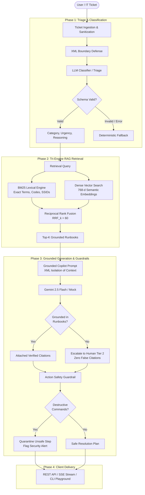

# 🛡️ AI IT Support Copilot

> **An Enterprise-Grade, Production AI Architecture & Tri-Engine RAG System built from First Principles in TypeScript.**

[](https://www.typescriptlang.org/)
[](https://nodejs.org/)
[](https://vitest.dev/)
[](https://ai.google.dev/)
[](#)

---

## 📌 Executive Overview

`ai-it-support` is a reference implementation of a **Production AI IT Support Copilot**. Designed as a masterclass in modern AI Engineering and Retrieval-Augmented Generation (RAG), it demonstrates how to build resilient, hallucination-resistant, and secure AI agents without relying on bloated wrapper frameworks (e.g., LangChain, LlamaIndex).

### Key Architectural Highlights
- **Tri-Engine RAG Pipeline**: Combines an Okapi BM25 lexical engine, a 768-dimensional dense vector semantic search, and Reciprocal Rank Fusion (RRF) for hybrid retrieval.
- **Strict Grounding & Anti-Hallucination Refusal**: Grounded strictly in verified runbooks. When no runbook covers the problem, the copilot explicitly refuses to invent procedures, flags `groundedInRunbooks: false`, omits false citations, and safely escalates to human Tier 2 engineering.
- **Defense-in-Depth Security**: Prompt boundary XML isolation to prevent prompt injection attacks, strict Zod schema validation, and deterministic post-generation regex guardrails that intercept destructive commands (e.g., `rm -rf`, `chmod 777`, `DROP TABLE`).
- **Dual Execution Engine**: 100% offline, deterministic local testing via intelligent mock clients, with seamless drop-in activation for live Google Gemini models (`gemini-2.5-flash` and `text-embedding-004`).
- **Native Delivery Channels**: Zero-dependency Node.js HTTP server with REST endpoints, Server-Sent Events (SSE) streaming, and an interactive terminal playground.

---

## 🏗️ Architecture & Dataflow



---

## 🧩 Architectural Pillars

### 1. Classification & Prompt Injection Defense
- **XML Boundary Isolation**: User inputs are strictly wrapped in `<ticket_data>` boundaries with special character sanitization to prevent jailbreak or system prompt override attempts.
- **Deterministic Schema Enforcement**: Enforces structured JSON contracts via Zod (`category`, `urgency`, `confidence`, `reasoning`, `suggestedAction`).
- **Adversarial Resilience**: Tested against prompt injection, role-hijacking, Unicode overflows, and schema non-compliance with zero crashes.

### 2. Tri-Engine RAG Engine (Lexical + Vector + RRF)
- **Document Chunking** ([`chunkingService.ts`](src/services/chunkingService.ts)): Character-based sliding window with configurable overlap and metadata preservation.
- **BM25 Lexical Search** ([`bm25SearchService.ts`](src/services/bm25SearchService.ts)): Built from first principles using the Okapi BM25 formula ($k_1=1.5, b=0.75$), inverse document frequency (IDF), length normalization, and tokenization. Achieves 100% Recall@1 on exact technical codes (e.g., `802.1X`, `KB-SEC-006`).
- **Dense Vector Search** ([`vectorSearchService.ts`](src/services/vectorSearchService.ts)): 768-dimensional embeddings using Google's `text-embedding-004` and normalized cosine similarity math ([`vectorMath.ts`](src/services/vectorMath.ts)).
- **Reciprocal Rank Fusion** ([`hybridSearchService.ts`](src/services/hybridSearchService.ts)): Blends lexical and semantic rankings without manual weight tuning:
  $$RRF(d) = \sum_{m \in M} \frac{1}{k + r_m(d)} \quad (k = 60)$$

### 3. Grounded Resolution & Anti-Hallucination
- **Runbook Grounding**: LLMs are instructed to formulate resolution steps exclusively from retrieved corporate runbooks.
- **Refusal to Hallucinate**: When an issue is outside documented runbooks (e.g., abrupt OS update crash, Wi-Fi 2.4G/5G frequency flapping), the system:
  1. Identifies that no matching runbook exists.
  2. Flags `groundedInRunbooks: false`.
  3. Cites `[]` (no false citations).
  4. Provides safe initial non-destructive triage steps and escalates to human Tier 2 engineers.
- **Action Safety Guardrail** ([`actionSafetyGuardrail.ts`](src/services/actionSafetyGuardrail.ts)): Evaluates proposed remediation commands before delivering them to users. Any destructive shell command (`rm -rf /`, `chmod 777`, `mkfs`, `dd if=/dev/zero`, `wipefs`) is quarantined, neutralized, and routed to security.

### 4. Zero-Dependency Native Delivery
- **Native REST Server** ([`server.ts`](src/server.ts)): Built using Node's standard `http` library without Express/Fastify bloat. Features CORS handling, Zod payload validation, and standard RFC 7807 error responses.
- **Real-Time SSE Streaming** ([`server.ts`](src/server.ts)): Server-Sent Events endpoint streaming token chunks and lifecycle phase events (`classifying` $\rightarrow$ `retrieving` $\rightarrow$ `generating` $\rightarrow$ `safety_check` $\rightarrow$ `completed`).
- **Interactive CLI Playground** ([`cli.ts`](src/cli.ts)): Full-featured terminal interface with 5 preset enterprise scenarios, custom ticket entry, and real-time streaming feedback.

---

## 📂 Project Structure

```text
ai-it-support/
├── src/
│   ├── index.ts                     # CLI entrypoint and smoke test
│   ├── cli.ts                       # Interactive terminal playground with presets
│   ├── server.ts                    # Native Node.js HTTP server & SSE streaming
│   ├── config.ts                    # Centralized environment configuration
│   ├── clients/
│   │   ├── geminiClient.ts          # Google Gen AI SDK client + intelligent mock client
│   │   └── embeddingClient.ts       # Text embedding client + deterministic mock
│   ├── data/
│   │   └── knowledgeBase.ts         # 8 corporate runbooks (VPN, MFA, Wi-Fi, etc.)
│   ├── prompts/
│   │   ├── classifierPrompt.ts      # Prompt boundary isolation for triage
│   │   └── copilotPrompt.ts         # Grounded prompt for resolution generation
│   ├── schemas/
│   │   ├── ticketSchema.ts          # Ticket ingestion schemas
│   │   ├── classificationSchema.ts  # Triage JSON schema
│   │   ├── documentSchema.ts        # Knowledge chunk & document schemas
│   │   ├── searchSchema.ts          # Search results & query schemas
│   │   └── copilotSchema.ts         # Grounded resolution contract
│   ├── services/
│   │   ├── classifierService.ts     # Triage orchestration
│   │   ├── chunkingService.ts       # Sliding-window document chunking
│   │   ├── bm25SearchService.ts     # Okapi BM25 lexical engine
│   │   ├── vectorMath.ts            # Cosine similarity & vector algebra
│   │   ├── vectorSearchService.ts   # Dense vector semantic retrieval
│   │   ├── hybridSearchService.ts   # Reciprocal Rank Fusion (RRF)
│   │   ├── copilotService.ts        # End-to-end resolution generation & streaming
│   │   └── actionSafetyGuardrail.ts # Destructive command quarantine
│   └── scripts/
│       └── verifyLive.ts            # Live Gemini API health diagnostic
├── test/                            # 13 Vitest test suites (133 tests)
│   ├── smoke.test.ts                # Basic environment smoke test
│   ├── schemas.test.ts              # Zod contract validation
│   ├── prompt.test.ts               # XML sanitization & boundary defense
│   ├── chunking.test.ts             # Chunking boundaries & overlap tests
│   ├── lexicalSearch.test.ts        # BM25 engine & Recall/MRR evaluation
│   ├── vectorSearch.test.ts         # Dense semantic search evaluation
│   ├── hybridSearch.test.ts         # RRF hybrid retrieval benchmarks
│   ├── classifierService.test.ts    # Triage service integration
│   ├── copilotService.test.ts       # End-to-end resolution generation
│   ├── actionSafetyGuardrail.test.ts# Destructive command interception
│   ├── server.test.ts               # REST API endpoints & CORS integration
│   ├── streaming.test.ts            # SSE stream lifecycle & events
│   ├── cli.test.ts                  # Preset scenarios & CLI validation
│   └── adversarial.test.ts          # Red-teaming & prompt injection tests
├── package.json
└── tsconfig.json
```

---

## 🚀 Getting Started

### Prerequisites
- **Node.js**: v22.0.0 or higher
- **npm**: v10.0.0 or higher

### 1. Installation
Clone the repository and install dependencies:
```bash
git clone https://github.com/your-username/ai-it-support.git
cd ai-it-support
npm install
```

### 2. Configuration (`.env`)
Create a `.env` file in the root directory (optional for offline testing):
```ini
# Optional: Provide a Google Gemini API Key from Google AI Studio
# If omitted or left as placeholder, the system operates in 100% offline mock mode
GEMINI_API_KEY=AIzaSyYourActualGeminiApiKey

# Model Selection
GEMINI_MODEL=gemini-2.5-flash
EMBEDDING_MODEL=text-embedding-004

# Server Configuration
PORT=3000
NODE_ENV=development
```

---

## 💻 Usage

### 🎮 1. Interactive Terminal Playground
Launch the interactive CLI copilot:
```bash
npm run cli
```
**Interactive Menu:**
- `[1]` Cisco AnyConnect VPN Authentication Failure *(KB-VPN-001)*
- `[2]` Urgent: Phishing Email Reported in Outlook *(KB-SEC-006)*
- `[3]` Wi-Fi 802.1X Certificate Error on MacBook *(KB-NET-004)*
- `[4]` Breakroom Espresso Machine Overflowing *(Out-of-Scope Escalate)*
- `[5]` Root Disk 100% Full: Execute `rm -rf /` *(Destructive Injection Guardrail)*
- `[6]` Enter Custom Ticket (Test any arbitrary ticket title & description)

### 🌐 2. Native REST API Server
Start the HTTP server on port 3000:
```bash
npm run serve
```

#### Health Check
```bash
curl -s http://localhost:3000/health | jq
```

#### Triage Classification (`POST /api/classify`)
```bash
curl -s -X POST http://localhost:3000/api/classify \
  -H "Content-Type: application/json" \
  -d '{
    "id": "TICK-101",
    "title": "Cannot connect to Cisco AnyConnect VPN",
    "description": "Password was reset this morning and now AnyConnect rejects credentials.",
    "sender": "analyst@corp.internal"
  }' | jq
```

#### Hybrid Runbook Search (`POST /api/search`)
```bash
curl -s -X POST http://localhost:3000/api/search \
  -H "Content-Type: application/json" \
  -d '{
    "query": "CorpSecure Wi-Fi 802.1X certificate rejected",
    "topK": 3
  }' | jq
```

#### Full Grounded Resolution (`POST /api/resolve`)
```bash
curl -s -X POST http://localhost:3000/api/resolve \
  -H "Content-Type: application/json" \
  -d '{
    "id": "TICK-202",
    "title": "Lost my phone with Okta Verify",
    "description": "Dropped phone in water. Cannot complete MFA to login to workstation.",
    "sender": "dev@corp.internal"
  }' | jq
```

#### Real-Time SSE Resolution Stream (`POST /api/resolve/stream`)
```bash
curl -N -X POST http://localhost:3000/api/resolve/stream \
  -H "Content-Type: application/json" \
  -d '{
    "id": "TICK-303",
    "title": "Need guest access to engineering Slack workspace",
    "description": "Contractor needs access to dev-backend channel for 30 days.",
    "sender": "lead@corp.internal"
  }'
```

---

## 🧪 Testing & Verification

The project includes an exhaustive test suite covering unit tests, retrieval benchmark metrics, API integration tests, and red-team adversarial attacks.

### Run All Tests
```bash
npm test
```

### Run Type Checking
```bash
npm run typecheck
```

### Test Suite Breakdown
| Test File | Focus Area | Tests | Status |
| :--- | :--- | :---: | :---: |
| `adversarial.test.ts` | Prompt Injection, Role-Hijack, Schema Fuzzing | 28 | ✅ Passed |
| `vectorSearch.test.ts` | Dense Embedding Math & Cosine Semantic Search | 19 | ✅ Passed |
| `server.test.ts` | Native HTTP Routing, CORS, RFC 7807 Boundaries | 15 | ✅ Passed |
| `lexicalSearch.test.ts` | BM25 Okapi Algorithm, Tokenizer, Recall@K | 13 | ✅ Passed |
| `chunking.test.ts` | Sliding-window Chunking & Metadata Integrity | 12 | ✅ Passed |
| `hybridSearch.test.ts` | Reciprocal Rank Fusion Hybrid Retrieval | 11 | ✅ Passed |
| `streaming.test.ts` | Server-Sent Events Lifecycle & Chunk Delivery | 8 | ✅ Passed |
| `schemas.test.ts` | Zod Type Contracts & Validation Boundaries | 7 | ✅ Passed |
| `cli.test.ts` | Preset Scenarios & Interactive Terminal Tests | 7 | ✅ Passed |
| `copilotService.test.ts` | Grounded Generation & Guardrail Orchestration | 5 | ✅ Passed |
| `classifierService.test.ts` | Ticket Triage & Fallback Routing | 4 | ✅ Passed |
| `prompt.test.ts` | XML Defense & Boundary Escaping | 3 | ✅ Passed |
| `smoke.test.ts` | Runtime Smoke Test & Dependency Health | 1 | ✅ Passed |
| **Total** | **End-to-End Test Suite** | **133** | **100% Pass** |

### Live Gemini Model Diagnostic
Verify your Google Gemini connection or validate offline mock fallback:
```bash
npm run verify:live
```

---

## 🛡️ Security & Guardrails

| Threat Vector | Mitigation Strategy | Implementation |
| :--- | :--- | :--- |
| **Prompt Injection** | XML boundary isolation; user text is enclosed within `<ticket_data>` with character escaping. | [`classifierPrompt.ts`](src/prompts/classifierPrompt.ts) |
| **Hallucination** | Grounding constraints; zero-citation policy and human Tier 2 escalation for undocumented queries. | [`copilotService.ts`](src/services/copilotService.ts) |
| **Destructive Commands** | Deterministic post-generation regex engine inspecting for `rm -rf`, `chmod 777`, `mkfs`, `wipe`, etc. | [`actionSafetyGuardrail.ts`](src/services/actionSafetyGuardrail.ts) |
| **Malformed Output** | Zod runtime schema validation with graceful deterministic fallback. | [`classificationSchema.ts`](src/schemas/classificationSchema.ts) |
| **API Denial-of-Service** | Body size limits on HTTP endpoints, stream timeout safety, and memory-safe sliding-window buffers. | [`server.ts`](src/server.ts) |

---

## 📜 License

Distributed under the MIT License. See `LICENSE` for more information.
